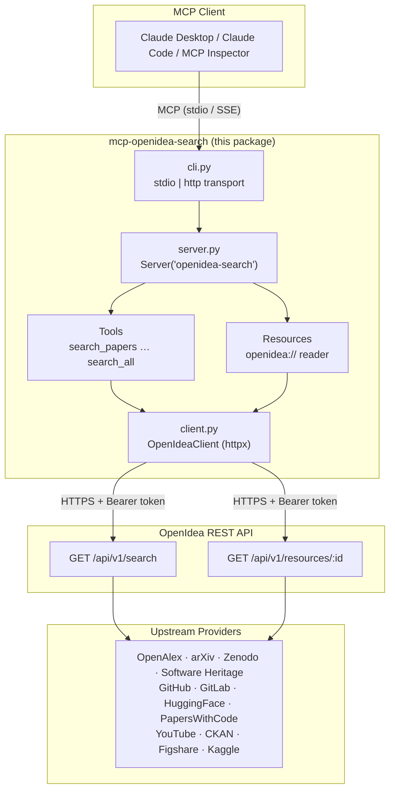
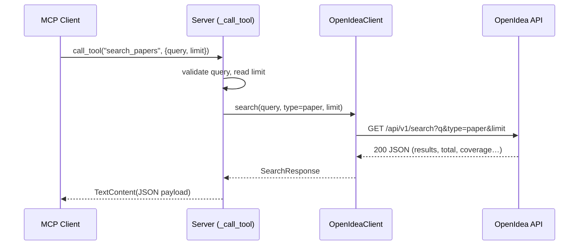
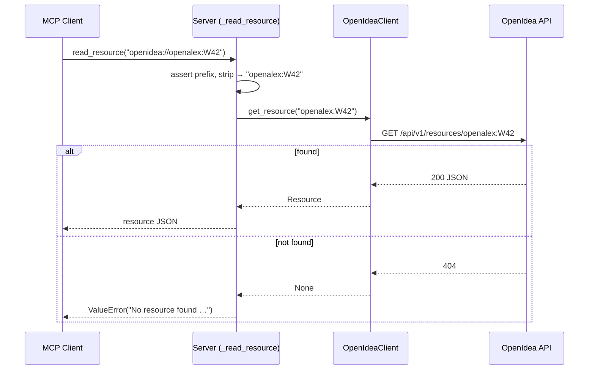
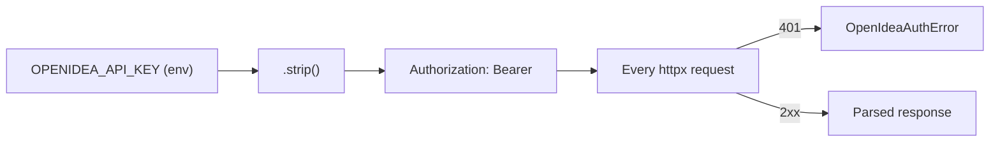

# Architecture

## Overview

`mcp-openidea-search` sits between an MCP client and the Open Idea REST API. It
translates MCP tool calls and resource reads into HTTP requests against
`/api/v1/*` on Open Idea, and translates the JSON responses back into MCP
content blocks. Open Idea itself fans the query out to upstream knowledge
providers (OpenAlex, GitHub, HuggingFace, YouTube, Zenodo, and others) and
returns a single normalized, de-duplicated result set.

## Purpose

This document explains the moving parts and the request lifecycles so engineers
and contributors can reason about, extend, and debug the server.

## Components

### MCP Client

Any MCP-compatible host: Claude Desktop, Claude Code, the MCP Inspector, Cursor,
etc. The client launches the server (over stdio) or connects to it (over
HTTP/SSE), discovers its tools and resource capabilities, and issues
`call_tool` / `read_resource` requests.

### MCP Server

This package. Defined in [server.py](../src/mcp_openidea_search/server.py) via
`build_server(client)`, which returns an `mcp.server.Server` named
`openidea-search`. It registers four handlers:

| Handler | Decorator | Responsibility |
|---|---|---|
| `_list_tools` | `@server.list_tools()` | Advertises the 7 search tools and their input schemas. |
| `_call_tool` | `@server.call_tool()` | Executes a tool, returning a `TextContent` JSON payload. |
| `_list_resources` | `@server.list_resources()` | Returns `[]` — resources are addressable but not enumerable. |
| `_read_resource` | `@server.read_resource()` | Resolves an `openidea://` URI to a single resource record. |

The transport is selected by the CLI in [cli.py](../src/mcp_openidea_search/cli.py):

- **stdio** — `_run_stdio` uses `mcp.server.stdio.stdio_server()`.
- **http** — `_run_http` wraps the server in a Starlette app with
  `SseServerTransport`, served by `uvicorn`. Routes: `GET /sse` (event stream)
  and `POST /messages/` (client → server messages).

### OpenIdea Client

[client.py](../src/mcp_openidea_search/client.py) — `OpenIdeaClient`, a thin
async wrapper over `httpx.AsyncClient`. It owns:

- Base URL + Bearer auth header construction.
- Default `timeout=10.0` seconds.
- A single retry on HTTP `429` (honoring `Retry-After`, capped at 5s).
- Conversion of HTTP `401` into `OpenIdeaAuthError`.
- Parsing JSON into the Pydantic models in
  [models.py](../src/mcp_openidea_search/models.py).

It exposes exactly two API methods: `search(...)` → `GET /api/v1/search`, and
`get_resource(id)` → `GET /api/v1/resources/{id}`.

### OpenIdea REST API

The upstream service at `https://www.openidea.world`. It performs the actual
federation across providers and returns normalized `Resource` records plus
`coverage` metadata describing which providers were queried and how many results
each returned.

### Upstream Providers

Open Idea aggregates from the providers enumerated in `ResourceProvider`
([models.py](../src/mcp_openidea_search/models.py)): `openalex`, `arxiv`,
`zenodo`, `swh` (Software Heritage), `ckan`, `huggingface`, `paperswithcode`,
`youtube`, `github`, `gitlab`, `figshare`, `kaggle`, and `custom`. This server
never talks to those providers directly — only to Open Idea.

## Architecture Diagram



Linear view:

```
Claude Desktop
      ↓  (MCP over stdio / SSE)
OpenIdea MCP Server
      ↓  (HTTPS + Bearer token)
OpenIdea REST API
      ↓  (server-side federation)
OpenAlex / GitHub / HuggingFace / YouTube / Zenodo / …
```

## Tool Execution Flow

For a preset tool (`search_papers`, `search_code`, `search_datasets`,
`search_models`, `search_hardware`, `search_videos`):

1. Client calls `call_tool(name, {query, limit})`.
2. `_call_tool` validates that `query` is present (raises `ValueError` if not)
   and reads `limit` (default 20).
3. The tool name is mapped to a `ResourceType` via `SEARCH_PRESETS`.
4. `client.search(query, type=<rtype>, limit=limit)` issues
   `GET /api/v1/search?q=…&limit=…&type=…`.
5. The JSON response is validated into `SearchResponse`, dumped to JSON
   (`exclude_none=True`), and returned as a single `TextContent` block.

For `search_all`:

- **No `types` filter** → one `GET /api/v1/search?q=…&limit=…` call; the full
  `SearchResponse` is returned.
- **With a `types` filter** → the server fans out **one request per requested
  type**, merges the results, **de-duplicates by `Resource.id`**, and returns
  `{"results": [...], "total": <merged count>}`. Unknown type strings are
  silently skipped.



## Resource Fetching Flow

1. Client calls `read_resource("openidea://<provider>:<id>")`.
2. `_read_resource` rejects any URI not starting with `openidea://`
   (`ValueError`).
3. It strips the `openidea://` prefix to obtain the `resource_id`.
4. `client.get_resource(resource_id)` issues
   `GET /api/v1/resources/{resource_id}`.
5. On HTTP `404`, `get_resource` returns `None`, and `_read_resource` raises
   `ValueError(f"No resource found for {uri}")`.
6. Otherwise the `Resource` is serialized with `model_dump_json(exclude_none=True)`
   and returned.

`_list_resources` always returns `[]`: resources cannot be enumerated. The
intended workflow is *search first to discover ids, then read by URI*.



## Authentication Flow

Authentication is a static Bearer token, established once at client
construction:

1. `OpenIdeaClient.__init__` reads `OPENIDEA_API_KEY` (and `OPENIDEA_API_URL`),
   `.strip()`-ing both.
2. The key is placed into a default header on the underlying
   `httpx.AsyncClient`: `Authorization: Bearer <key>`, alongside
   `User-Agent: mcp-openidea-search/0.1` and `Accept: application/json`.
3. Every request inherits that header.
4. If Open Idea responds with `401`, `_request` raises `OpenIdeaAuthError`
   (`"Open Idea rejected the API key (401)."`).



There is **no token refresh or OAuth flow** — the key is long-lived until
revoked at the Open Idea developer console.

## Error & Retry Semantics

| Condition | Handled in | Behavior |
|---|---|---|
| HTTP 429 | `client._request` | Sleep `min(Retry-After, 5.0)`s, retry **once**. |
| HTTP 401 | `client._request` | Raise `OpenIdeaAuthError`. |
| HTTP 404 (resource) | `client.get_resource` | Return `None`. |
| Other 4xx/5xx | `client.search` / `get_resource` | `raise_for_status()` → `httpx.HTTPStatusError`. |
| Missing `query` | `server._call_tool` | `ValueError("`query` is required.")` |
| Bad resource URI | `server._read_resource` | `ValueError`. |

## Data Models

See [api-reference.md](api-reference.md#data-models) for full field tables.
Models live in [models.py](../src/mcp_openidea_search/models.py) and use Pydantic
v2 with `extra="allow"`, so additional fields returned by Open Idea are
preserved rather than dropped.
