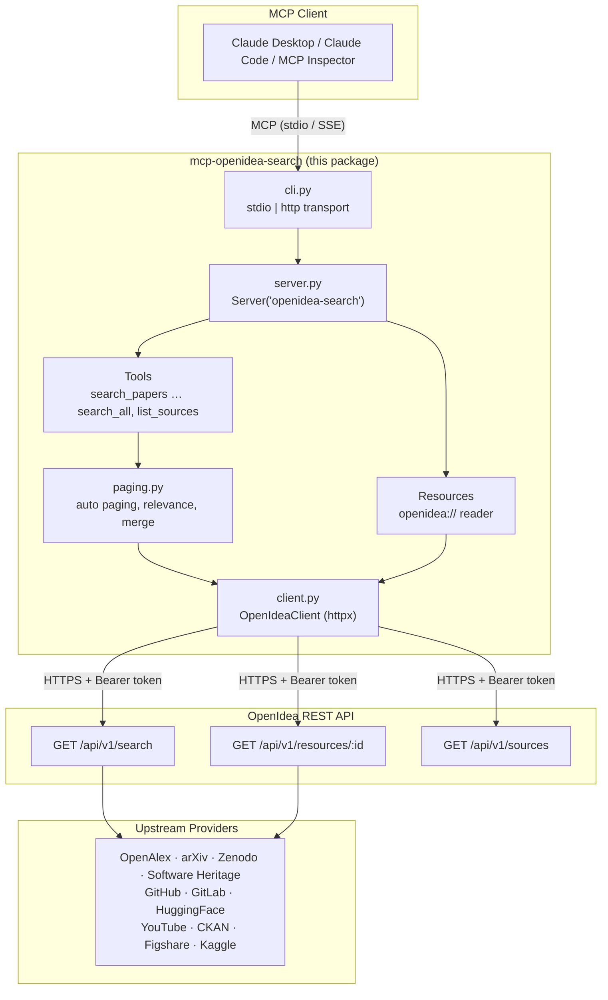
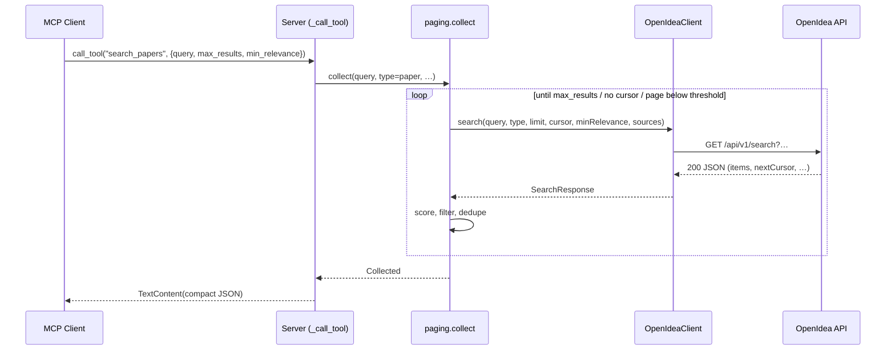
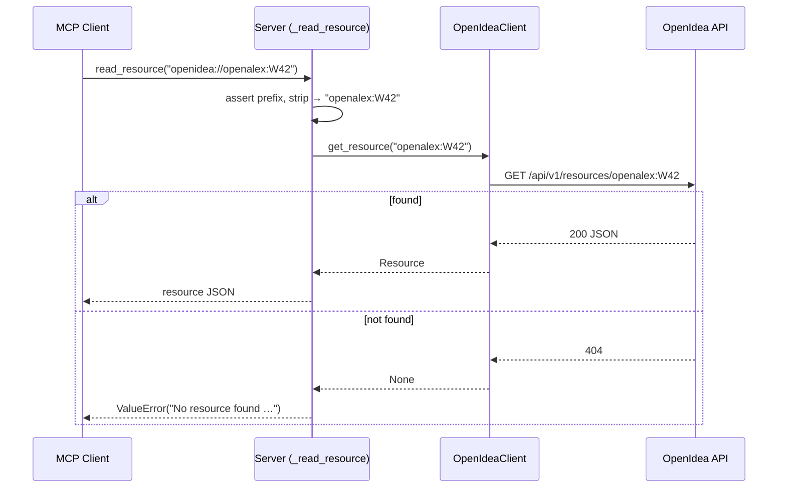
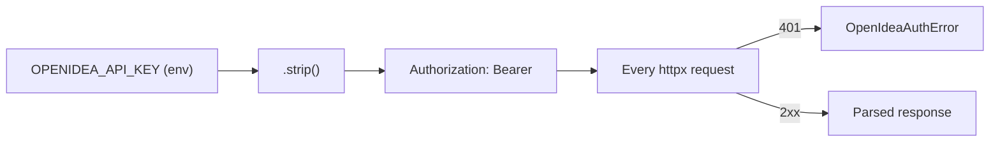

# Architecture

## Overview

`mcp-openidea-search` sits between an MCP client and the Open Idea REST API. It
translates MCP tool calls and resource reads into HTTP requests against
`/api/v1/*` on Open Idea, and translates the JSON responses back into MCP
content blocks. Open Idea itself fans the query out to upstream knowledge
providers (OpenAlex, GitHub, HuggingFace, YouTube, Zenodo, and others) and
returns a single normalized, de-duplicated result set.

## Purpose

This document explains the moving parts and the request lifecycles so engineers
and contributors can reason about, extend, and debug the server.

## Components

### MCP Client

Any MCP-compatible host: Claude Desktop, Claude Code, the MCP Inspector, Cursor,
etc. The client launches the server (over stdio) or connects to it (over
HTTP/SSE), discovers its tools and resource capabilities, and issues
`call_tool` / `read_resource` requests.

### MCP Server

This package. Defined in [server.py](../src/mcp_openidea_search/server.py) via
`build_server(client)`, which returns an `mcp.server.Server` named
`openidea-search`. It registers four handlers:

| Handler | Decorator | Responsibility |
|---|---|---|
| `_list_tools` | `@server.list_tools()` | Advertises the 7 search tools and `list_sources`, with their input schemas. |
| `_call_tool` | `@server.call_tool()` | Executes a tool, returning a `TextContent` JSON payload. |
| `_list_resources` | `@server.list_resources()` | Returns `[]` — resources are addressable but not enumerable. |
| `_read_resource` | `@server.read_resource()` | Resolves an `openidea://` URI to a single resource record. |

The transport is selected by the CLI in [cli.py](../src/mcp_openidea_search/cli.py):

- **stdio** — `_run_stdio` uses `mcp.server.stdio.stdio_server()`.
- **http** — `_run_http` wraps the server in a Starlette app with
  `SseServerTransport`, served by `uvicorn`. Routes: `GET /sse` (event stream)
  and `POST /messages/` (client → server messages).

### Paging

[paging.py](../src/mcp_openidea_search/paging.py) holds the search logic the
tools share, separate from the MCP plumbing so it can be tested directly:

- `collect(...)` — one type (or no type): auto mode pages through
  `GET /api/v1/search`, page mode makes one request. It computes each result's
  relevance, drops results below `min_relevance` or outside `sources`, and
  reports why it stopped.
- `collect_many(...)` — runs `collect` per type with `asyncio.gather`, merges,
  de-duplicates by id and sorts by relevance.
- `render(...)` — compact or full output for one result.

### OpenIdea Client

[client.py](../src/mcp_openidea_search/client.py) — `OpenIdeaClient`, a thin
async wrapper over `httpx.AsyncClient`. It owns:

- Base URL + Bearer auth header construction.
- Default timeout of 30 seconds (`OPENIDEA_TIMEOUT` overrides).
- At most one retry per request: on HTTP `429` (honoring `Retry-After`, capped
  at 5s), on `5xx`, and on connection errors (0.5s pause). Read timeouts are
  not retried.
- Conversion of HTTP `401` into `OpenIdeaAuthError`.
- Parsing JSON into the Pydantic models in
  [models.py](../src/mcp_openidea_search/models.py).

It exposes three API methods: `search(...)` → `GET /api/v1/search` (with
optional `minRelevance` and `sources`), `get_resource(id)` →
`GET /api/v1/resources/{id}`, and `list_sources()` → `GET /api/v1/sources`
(`None` on 404, for servers that predate it).

### OpenIdea REST API

The upstream service at `https://www.openidea.world`. It performs the actual
federation across providers and returns normalized `Resource` records plus
`coverage` metadata describing which providers were queried and how many results
each returned.

### Upstream Providers

Open Idea aggregates from providers such as `openalex`, `arxiv`, `zenodo`,
`swh` (Software Heritage), `ckan`, `huggingface`, `youtube`, `github`,
`gitlab`, `figshare` and `kaggle`, and adds more over time. `Resource.source`
is therefore a plain string, and `list_sources` reads the live list from
`GET /api/v1/sources` where the server has it. This server never talks to those
providers directly — only to Open Idea.

## Architecture Diagram



Linear view:

```
Claude Desktop
      ↓  (MCP over stdio / SSE)
OpenIdea MCP Server
      ↓  (HTTPS + Bearer token)
OpenIdea REST API
      ↓  (server-side federation)
OpenAlex / GitHub / HuggingFace / YouTube / Zenodo / …
```

## Tool Execution Flow

For a preset tool (`search_papers`, `search_code`, `search_datasets`,
`search_models`, `search_hardware`, `search_videos`):

1. Client calls `call_tool(name, {query, max_results, min_relevance, mode, …})`.
2. `_call_tool` checks `query`, maps the tool name to a `ResourceType` via
   `SEARCH_PRESETS`, and hands off to `run_search`, which clamps the inputs
   (`max_results` 1–500, `min_relevance` 0–1).
3. `paging.collect` runs the search:
   - **auto**: request `limit = min(remaining, 100)`; score each result
     (server `relevance`, else `score / top score of the first page`); keep
     those at or above `min_relevance` and in `sources`; follow `nextCursor`
     (or `page + 1` when only `hasMore` is sent). Stop on `max_results`, no more
     pages, a page entirely below `min_relevance`, or 25 pages.
   - **page**: one request at `page` / `cursor`.
4. Results are rendered compact (default) or full and returned as one
   `TextContent` JSON block with `query`, `total_returned`, `stopped_because`,
   `results` and `next_cursor`.

For `search_all`:

- **No `types`, or one** → same as a preset.
- **Several `types`** → `paging.collect_many` runs one collection per type
  concurrently (`asyncio.gather`), merges, de-duplicates by `Resource.id`
  (higher relevance wins), sorts by relevance, trims to `max_results`, and adds
  per-type status under `by_type`. One failing type does not fail the call
  unless all fail or the key is rejected.

For `list_sources`: `client.list_sources()`; a 404 becomes
`{"supported": false, "message": …}` so the model can explain that the server
does not offer it yet.



## Resource Fetching Flow

1. Client calls `read_resource("openidea://<provider>:<id>")`.
2. `_read_resource` rejects any URI not starting with `openidea://`
   (`ValueError`).
3. It strips the `openidea://` prefix to obtain the `resource_id`.
4. `client.get_resource(resource_id)` issues
   `GET /api/v1/resources/{resource_id}`.
5. On HTTP `404`, `get_resource` returns `None`, and `_read_resource` raises
   `ValueError(f"No resource found for {uri}")`.
6. Otherwise the `Resource` is serialized with `model_dump_json(exclude_none=True)`
   and returned.

`_list_resources` always returns `[]`: resources cannot be enumerated. The
intended workflow is *search first to discover ids, then read by URI*.



## Authentication Flow

Authentication is a static Bearer token, established once at client
construction:

1. `OpenIdeaClient.__init__` reads `OPENIDEA_API_KEY` (and `OPENIDEA_API_URL`),
   `.strip()`-ing both.
2. The key is placed into a default header on the underlying
   `httpx.AsyncClient`: `Authorization: Bearer <key>`, alongside
   `User-Agent: mcp-openidea-search/0.1` and `Accept: application/json`.
3. Every request inherits that header.
4. If Open Idea responds with `401`, `_request` raises `OpenIdeaAuthError`
   (`"Open Idea rejected the API key (401)."`).



There is **no token refresh or OAuth flow** — the key is long-lived until
revoked at the Open Idea developer console.

## Error & Retry Semantics

| Condition | Handled in | Behavior |
|---|---|---|
| HTTP 429 | `client._request` | Sleep `min(Retry-After, 5.0)`s, retry **once**. |
| HTTP 5xx | `client._request` | Sleep 0.5s, retry **once**. |
| Connect error / connect timeout | `client._request` | Sleep 0.5s, retry **once**. |
| Read timeout | — | Not retried (default timeout 30s, `OPENIDEA_TIMEOUT`). |
| HTTP 401 | `client._request` | Raise `OpenIdeaAuthError`. |
| HTTP 404 (resource) | `client.get_resource` | Return `None`. |
| HTTP 404 (sources) | `client.list_sources` | Return `None`; the tool explains the server lacks it. |
| Other 4xx/5xx after retry | `client.search` / `get_resource` / `list_sources` | `raise_for_status()` → `httpx.HTTPStatusError`. |
| One type fails in multi-type `search_all` | `paging.collect_many` | Reported under `by_type`; the others return. |
| Missing `query` | `server._call_tool` | `ValueError("`query` is required.")` |
| Bad resource URI | `server._read_resource` | `ValueError`. |

## Compatibility with older servers

| Newer server feature | Older server behavior | What this package does |
|---|---|---|
| Per-result `relevance` | Only `score` | Relevance = `score / first-page top score`. |
| `minRelevance` param | Ignored | Filters on this side too. |
| `sources` param | Ignored | Drops non-matching `source` on this side too. |
| `nextCursor` | May be absent | Steps `page` while `hasMore` is true. |
| `GET /api/v1/sources` | 404 | `list_sources` reports `supported: false`. |
| New provider names | — | `source` is a free string, so they validate. |

## Data Models

See [api-reference.md](api-reference.md#data-models) for full field tables.
Models live in [models.py](../src/mcp_openidea_search/models.py) and use Pydantic
v2 with `extra="allow"`, so additional fields returned by Open Idea are
preserved rather than dropped.
